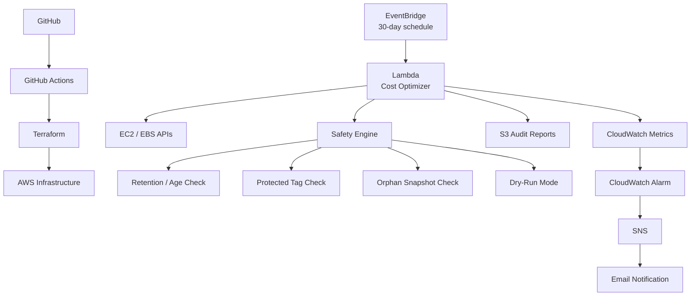

# AWS Cost Optimization Engine

An automated AWS cost optimization engine that identifies old and orphaned EBS snapshots, applies safety controls before cleanup, publishes operational metrics to CloudWatch, stores audit reports in Amazon S3, and sends alerts through SNS.

The infrastructure is provisioned with Terraform and the application is tested through GitHub Actions.

---

## Architecture



### Runtime flow

```text
EventBridge
    |
    v
Lambda
    |
    +--> Discover EBS snapshots
    |
    +--> Discover EBS volumes
    |
    +--> Apply safety rules
    |      +-- Retention age
    |      +-- Protected tag
    |      +-- Source volume existence
    |      +-- Dry-run mode
    |
    +--> Delete eligible snapshots
    |
    +--> Publish CloudWatch metrics
    |
    +--> Store JSON audit report in S3
    |
    v
CloudWatch Alarm --> SNS --> Email
```

---

## What the project does

The engine automates a common AWS cost-management task: finding EBS snapshots that are old and no longer associated with an existing source volume.

A snapshot becomes a cleanup candidate only after passing the configured safety rules.

### Current safety rules

1. Snapshot must be older than the configured retention period.
2. Snapshots with the configured protected tag are skipped.
3. Snapshots whose source EBS volume still exists are skipped.
4. `DRY_RUN=true` prevents deletion.
5. AWS API pagination is used when discovering snapshots and volumes.
6. Cleanup errors are captured and reported.
7. Every execution produces an audit report in S3.

---

## AWS Services

| Service | Purpose |
|---|---|
| AWS Lambda | Runs the cost optimization engine |
| Amazon EventBridge | Schedules Lambda execution |
| Amazon EC2 / EBS | Snapshot and volume discovery/cleanup |
| IAM | Least-privilege Lambda permissions |
| Amazon S3 | Stores JSON audit reports |
| CloudWatch | Logs and custom application metrics |
| CloudWatch Alarm | Detects cleanup errors |
| Amazon SNS | Sends alert notifications |
| Terraform | Provisions AWS infrastructure |
| GitHub Actions | Runs automated tests and Terraform validation |

---

## Project Structure

```text
aws-cost-optimization-engine/
│
├── .github/
│   └── workflows/
│       └── ci.yml
│
├── lambda_package/
│   └── src/
│       ├── audit.py
│       ├── cleanup.py
│       ├── config.py
│       ├── handler.py
│       ├── metrics.py
│       ├── snapshot_analyzer.py
│       └── utils.py
│
├── src/
│   ├── audit.py
│   ├── cleanup.py
│   ├── config.py
│   ├── handler.py
│   ├── metrics.py
│   ├── snapshot_analyzer.py
│   └── utils.py
│
├── tests/
│   ├── test_audit.py
│   ├── test_cleanup.py
│   ├── test_metrics.py
│   └── test_snapshot_analyzer.py
│
├── terraform/
│   ├── eventbridge.tf
│   ├── iam.tf
│   ├── lambda.tf
│   ├── monitoring.tf
│   ├── outputs.tf
│   ├── s3.tf
│   ├── variables.tf
│   └── main.tf
│
├── requirements.txt
└── README.md
```

---

## Prerequisites

- AWS account
- AWS CLI configured
- Terraform >= 1.5
- Python 3.11+
- Git
- GitHub repository

Verify:

```bash
aws --version
terraform --version
python --version
git --version
```

---

# Deployment

## 1. Clone the repository

```bash
git clone https://github.com/Adhikesavan12/aws-cost-optimization-engine.git
cd aws-cost-optimization-engine
```

## 2. Create Python environment

```bash
python -m venv .venv
```

Linux/macOS:

```bash
source .venv/bin/activate
```

Windows Git Bash:

```bash
source .venv/Scripts/activate
```

Install dependencies:

```bash
pip install -r requirements.txt
```

---

## 3. Run tests

```bash
python -m pytest
```

The project contains unit tests for:

- Snapshot analysis
- Cleanup behavior
- Audit report generation
- CloudWatch metric publishing

---

## 4. Configure AWS credentials

Configure the AWS CLI using your preferred authentication method:

```bash
aws configure
```

Verify:

```bash
aws sts get-caller-identity
```

---

## 5. Initialize Terraform

```bash
cd terraform
terraform init
```

Validate:

```bash
terraform fmt
terraform validate
```

Review the infrastructure:

```bash
terraform plan
```

---

## 6. Deploy infrastructure

Deploy:

```bash
terraform apply
```

Terraform provisions:

- S3 audit bucket
- Lambda execution role
- IAM policies
- Lambda function
- EventBridge schedule
- EventBridge → Lambda permission
- CloudWatch custom metric alarm
- SNS topic
- SNS email subscription

For the SNS email subscription, Terraform requires an email variable:

```bash
terraform apply -var="alert_email=YOUR_EMAIL@example.com"
```

AWS SNS sends a confirmation email. Click **Confirm subscription**.

---

# Configuration

The Lambda environment variables control the cleanup behavior.

| Variable | Default | Description |
|---|---:|---|
| `RETENTION_DAYS` | `90` | Minimum snapshot age before it can become a candidate |
| `DRY_RUN` | `true` | Prevents actual snapshot deletion |
| `PROTECTED_TAG_KEY` | `Protected` | Tag key used to protect snapshots |
| `PROTECTED_TAG_VALUE` | `true` | Tag value that prevents deletion |
| `AUDIT_BUCKET` | Terraform-created bucket | S3 bucket for audit reports |

### Safety recommendation

Keep:

```text
DRY_RUN=true
```

while testing.

Only enable deletion after reviewing the audit results and confirming the cleanup rules behave as expected.

---

# EventBridge Schedule

The current Terraform configuration uses:

```text
rate(30 days)
```

This invokes the Lambda approximately every 30 days.

The Lambda can also be invoked manually:

```bash
aws lambda invoke \
  --region us-east-1 \
  --function-name aws-cost-optimizer \
  response.json
```

View the result:

```bash
cat response.json
```

Example:

```json
{
  "candidates": 0,
  "deleted": 0,
  "skipped": 0,
  "errors": 0
}
```

---

# S3 Audit Reports

Each Lambda execution creates a JSON audit report.

Example path:

```text
reports/2026/10/20/cost-optimization-20261020-112128.json
```

List reports:

```bash
aws s3 ls s3://YOUR_BUCKET_NAME/reports/ --recursive
```

Read a report:

```bash
aws s3 cp \
s3://YOUR_BUCKET_NAME/reports/YYYY/MM/DD/REPORT.json \
-
```

Example report:

```json
{
  "timestamp": "2026-10-20T11:21:28+00:00",
  "summary": {
    "candidates": 0,
    "deleted": 0,
    "skipped": 0,
    "errors": 0
  },
  "deleted_snapshots": [],
  "errors": []
}
```

---

# CloudWatch Metrics

The Lambda publishes metrics under:

```text
AWS/CostOptimizer
```

Metrics:

```text
SnapshotsAnalyzed
SnapshotsDeleted
SnapshotsSkipped
CleanupErrors
```

View them:

```bash
aws cloudwatch list-metrics \
  --namespace AWS/CostOptimizer \
  --region us-east-1
```

The `CleanupErrors` metric is connected to a CloudWatch alarm.

---

# Monitoring and Alerting

```text
Lambda
  |
  v
CloudWatch Metrics
  |
  v
CleanupErrors Alarm
  |
  v
SNS Topic
  |
  v
Email
```

The alarm triggers when:

```text
CleanupErrors > 0
```

SNS email subscriptions must be confirmed before notifications can be delivered.

---

# GitHub Actions

The CI pipeline runs on pushes and pull requests.

Workflow:

```text
GitHub Push / Pull Request
          |
          +--> Python Tests
          |
          +--> Terraform Init
          |
          +--> Terraform Format Check
          |
          +--> Terraform Validate
```

The workflow intentionally does not automatically run:

```text
terraform apply
```

This prevents an ordinary Git push from changing AWS infrastructure.

---

# IAM Security

The Lambda execution role follows least-privilege principles for the application's required AWS APIs.

EC2 permissions:

```text
ec2:DescribeSnapshots
ec2:DescribeVolumes
ec2:DeleteSnapshot
```

CloudWatch:

```text
cloudwatch:PutMetricData
```

S3:

```text
s3:PutObject
```

CloudWatch Logs are provided through:

```text
AWSLambdaBasicExecutionRole
```

The Lambda role can only be assumed by the Lambda service.

---

# S3 Security

The audit bucket should remain private and should never be publicly accessible.

Recommended Terraform controls:

```hcl
resource "aws_s3_bucket_public_access_block" "audit" {
  bucket = aws_s3_bucket.audit.id

  block_public_acls       = true
  block_public_policy     = true
  ignore_public_acls      = true
  restrict_public_buckets = true
}

resource "aws_s3_bucket_server_side_encryption_configuration" "audit" {
  bucket = aws_s3_bucket.audit.id

  rule {
    apply_server_side_encryption_by_default {
      sse_algorithm = "AES256"
    }
  }
}

resource "aws_s3_bucket_versioning" "audit" {
  bucket = aws_s3_bucket.audit.id

  versioning_configuration {
    status = "Enabled"
  }
}
```

A lifecycle policy can also remove old audit reports to control storage costs.

---

# Testing Strategy

The project uses unit tests to validate the application logic without making real AWS deletion calls.

Run:

```bash
python -m pytest
```

Test coverage includes:

### Snapshot analysis

- Recent snapshots are skipped.
- Snapshots with existing source volumes are skipped.
- Orphaned old snapshots become candidates.
- Protected snapshots are skipped.

### Cleanup

- Dry-run mode does not delete snapshots.
- Cleanup errors are captured.

### Audit

- Audit report contains execution summary.
- S3 upload creates the expected report structure.

### Metrics

- CloudWatch metric payload is generated correctly.

---

# Safety Model

The cleanup engine is designed around a **detect → validate → protect → act → audit** workflow.

```text
Discover
   ↓
Age Check
   ↓
Protected Tag?
   ├── Yes → Skip
   └── No
        ↓
Source Volume Exists?
   ├── Yes → Skip
   └── No
        ↓
DRY_RUN?
   ├── Yes → Report only
   └── No → Delete
        ↓
Publish Metrics
        ↓
Write Audit Report
```

This reduces the chance of accidentally deleting snapshots that are still relevant.

---

# Production Considerations

Before using the project for automated deletion in a production AWS account:

- Keep `DRY_RUN=true` during initial validation.
- Review audit reports before enabling deletion.
- Use a dedicated IAM role.
- Protect important snapshots with tags.
- Test retention settings against real backup requirements.
- Keep audit reports in a private S3 bucket.
- Enable S3 encryption and public-access blocking.
- Monitor `CleanupErrors`.
- Consider using AWS Backup policies for formal backup requirements rather than relying solely on custom cleanup logic.

---

# Cleanup

When finished testing, destroy the Terraform-managed infrastructure:

```bash
cd terraform
terraform destroy
```

Confirm:

```text
yes
```

Verify that resources are removed:

```bash
terraform state list
```

> Do not run `terraform destroy` if you still need the deployed environment or audit reports.

---

# Skills Demonstrated

- AWS Lambda
- Amazon EC2 / EBS
- Amazon S3
- Amazon EventBridge
- Amazon CloudWatch
- Amazon SNS
- AWS IAM
- Terraform
- Python
- Boto3
- Pytest
- Git
- GitHub Actions
- CI/CD
- Infrastructure as Code
- Least-privilege IAM
- Cloud cost optimization
- Automated operational reporting
- Observability and alerting

---

# Project Outcome

This project demonstrates an automated AWS cost-management workflow that combines application code, infrastructure as code, CI/CD, scheduling, security, observability, alerting, and auditability.

The design separates infrastructure provisioning from runtime business logic:

```text
Terraform
    ↓
Creates AWS infrastructure

Lambda
    ↓
Executes cost-optimization logic

EventBridge
    ↓
Schedules execution

CloudWatch
    ↓
Provides observability

SNS
    ↓
Provides alerting

S3
    ↓
Provides audit history

GitHub Actions
    ↓
Validates application and infrastructure changes
```

